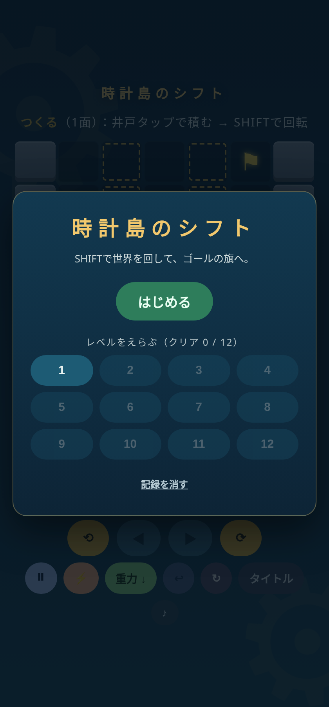
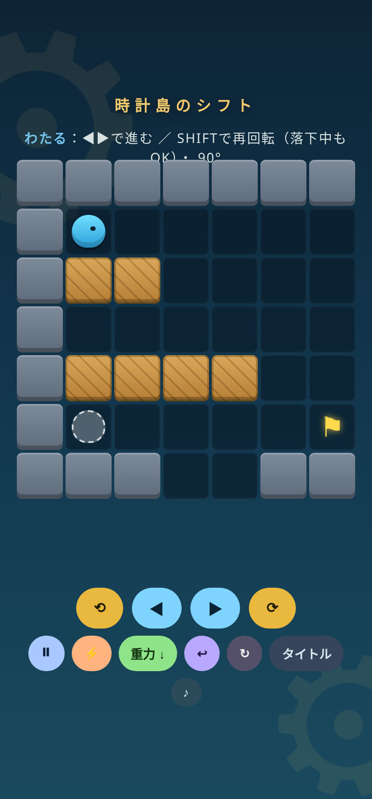
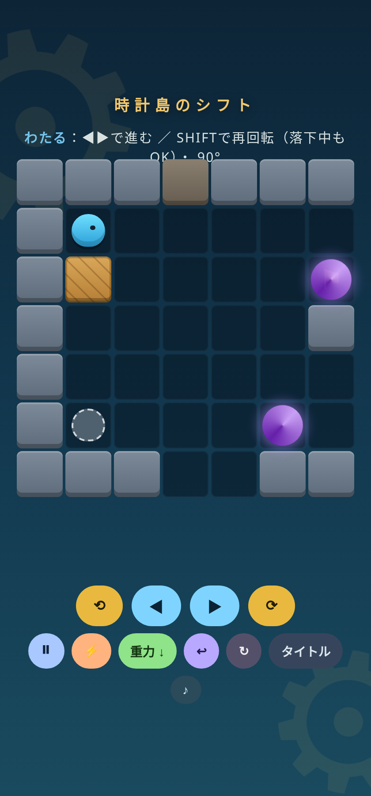

# 時計島のシフト（Clock Island Shift）

時計仕掛けの浮島を舞台にした、7×7マスのパズルゲームです。
ブロックを積んで足場を作り、世界そのものを90度回転（SHIFT）させて、ゴールの旗を目指します。

GitHub Game Off 2026（テーマ：SHIFT）参加作品です。

## 遊び方

ゲームは2つのフェーズを行き来します。

1. **つくる**：井戸（点線で光る列）をタップして、木箱ブロックを積みます。積んだブロックのてっぺんをタップすると取り除けます。使えるブロック数には上限があります。
2. **わたる**：⟲ / ⟳ ボタンで世界を90度回転させると、積んだブロックが足場や壁に変わります。◀ ▶ で進み、ゴールの旗にたどり着けばクリアです。回転は落下の途中でもできます。回転は各面1回（10面は2回）で、残り回数は画面に表示されます。↩で戻せば回転回数も戻ります。箱は、その上から離れると消えます。

全12面。クリアした面はタイトル画面から選んで遊べます。進み具合はブラウザに保存されます。

各面のヒントは盤面の上に表示されます。使える現象は島ごとに変わり、対象外の操作はキーボードからも使えません。

## 操作

| 操作 | ボタン | キーボード |
|---|---|---|
| ブロックを積む／取り除く | 井戸をタップ | ― |
| 世界を回転（SHIFT） | ⟲ / ⟳ | Space（時計回り） / Q（反時計回り） |
| 左右に進む | ◀ / ▶ | ← / → |
| 上下に浮遊（無重力のとき） | ▲ / ▼ | ↑ / ↓ |
| 時間停止 | ⏸ | T |
| 早送り（勢いをつける） | ⚡ | F |
| 着地して重力を切り替え（6・12面：下↔上／9面：下↔無重力） | 重力ボタン | G |
| 巻き戻し | ↩ | Z |
| この面を最初から | ↻ | R |
| BGM オン／オフ | ♪ | ― |

## 現象（シフト）一覧

全11種類の現象を、島ごとに少しずつ学びます。すべての現象を常に使えるわけではありません。

| 現象 | 内容 |
|---|---|
| 回転 | 世界を90度回転させる。地形もブロックもすべて回る |
| 落下 | 重力で下へ落ちる。落ちた距離が「勢い」になる |
| 逆重力（上昇） | 重力を反転させ、天井へ向かって昇る |
| 無重力 | 重力を消して、上下左右に浮いて進む |
| 時間停止 | 落下の途中で時間を止める |
| 巻き戻し | 直前の操作を取り消す |
| 早送り（勢い） | 落下を速くして勢いを倍にする。勢い3以上でヒビ床を割れる |
| バウンド | 勢いよく着地すると、進んでいた向きへ斜めに跳ね返る |
| 風 | 落下・上昇のたびに、横へ1マス流される |
| 残像 | 回転した瞬間、元の場所に残像が残って足場になる |
| ワープ | 紫の渦に入ると、対の渦へ瞬間移動する |

[全12面の学習設計・意図解・検証範囲](docs/PROGRESSION-2026-11-09.md)を開発資料として公開しています（解法のネタバレを含みます）。

## 動かし方

`index.html` をブラウザで開くだけで遊べます。ゲーム本体は単一のHTMLファイルで、ゲームプレイに外部ファイルや通信は不要です。タブのアイコン表示には同じフォルダの `favicon.svg` を使用します。効果音とBGMは Web Audio でその場で合成しています（音が出るのは、画面を一度タップ／クリックしてからです）。

## ライセンス

MIT License（[LICENSE](LICENSE) 参照）。

制作：birdman studio（TORII, Hiroki）

## 品質確認

依存パッケージ不要の回帰テスト: `node --test tests/regression.cjs`（Node.js 22以上）。
[最新の設計・検証範囲](docs/PROGRESSION-2026-11-09.md)では、全12面の解法再生、箱なしの経路探索、現象を外した探索、割り込み操作と保存の回帰を分けています。[追加ブラウザQA](docs/QA-PR2-BROWSER.md)で2サイズの表示・全12面のクリック操作・保存互換も確認しています。実機・初見評価は未確認です。

[前回の基礎QA記録](docs/QA-2026-11-09.md)は変更前の地形・画面に対する履歴です。
