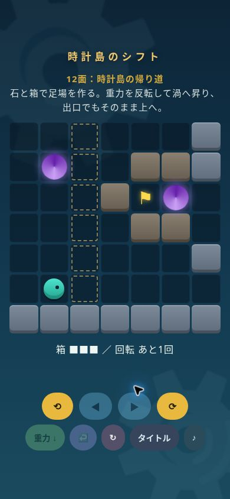
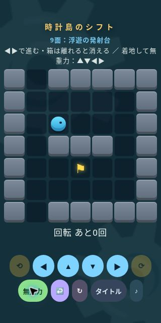

# PR #2 追加ブラウザQAと独立レビュー

2026-11-09。クラウドChromeで検証。実機タッチ、Safari、音の聞こえ方、初見プレイヤーによる理解度・難易度評価は含みません。

## 対象と方法

- 実際の `index.html` を変更せず確認用の同一オリジンiframeに読み込み、CSS viewportを390×844 / 320×640に設定。画像の縮小ではありません。
- 検証用UIはviewport・面の選択とテストセーブ投入のみを担当します。解法はゲーム内の井戸・回転・移動・現象ボタンへのブラウザクリックで実行しました。ゲーム関数を直接呼んでクリアした結果ではありません。
- 最終ゲームHTMLのSHA-256: `471ef3500ee9d1120a227a66a9acd45f6b06ceea3cd8ec53acab2d8274272775`。

## 表示

| 確認 | 結果 |
|---|---|
| 12面すべての開始画面 × 2サイズ（24状態） | 横・縦のdocument overflowなし。面名・ヒント・盤面が重ならない |
| 320×640 開始画面 | controls下端598.14px。phase下端131.23px、盤面上端137.23px |
| 390×844 開始画面 | controls下端762.47px。phase下端192.53px、盤面上端206.53px |
| 320×640 9面の無重力状態 | ▲▼を含めて全操作が収まる。controls下端598.14px |
| 320×640 9面クリア後 | 次面ボタンが増えてもcontrols下端623.14px、document高さ640px |

## 操作・保存

- **全12面**を320×640のブラウザで、`solutions.json` の意図解に沿って最初からクリック操作し、それぞれ「クリア！」を確認。
- 1・12面は390×844でも操作してクリアを確認。
- 4面で時間停止 → 空中位置を維持 → 再開 → 着地 → 巻き戻しを確認。離れて消えた箱が復元され、リセットで箱5個・回転1回に戻る。
- 新規進行で1面をクリアしてリロードし、「クリア1/12」「つづきから（2面）」を確認。
- 旧v1形式の `{ unlocked:9, cleared:[true,true,true,true,true,true,true,true] }` をテスト用保存領域へ投入し、1〜8面の記録保持・9面から継続・10〜12面のロックを確認。
- 全12面クリア後のリロードで「クリア12/12」「つづきから（12面）」を確認。
- 保存キー・形式は変更しない。古い盤面で獲得したクリア記録も保持する方針。既存の進行を消して新パズルを強制しない。

## 独立レビューと修正後の確認

実装担当とは別のレビューで、差分・基準版・探索モデル・保存互換・タイマー割り込みを確認。重大な回帰や箱なしの抜け道は見つかりませんでした。

レビューが指摘した既存の端ケースを、この変更で合わせて修正しました。

1. 最終面クリア直後にタイトルへ戻ると、遅延した全クリア表示がレベル選択を上書きする。
2. 最終面クリア直後に巻き戻して失敗すると、同じ状態オブジェクトを参照する遅延表示が「おちた」の上に全クリアを出す。

タイトル・リセット・有効な巻き戻しで完了タイマーを解除し、コールバックも「クリア！」を条件にしました。独立レビューの実時間順タイマーモデルで再現しなくなり、**64回帰テストが成功**。ブラウザでも最終面クリア → 巻き戻しで箱なしまで戻す → 回転して落下を行い、「おちた」のまま全クリア画面が出ないことを確認しました。

12面の操作説明は、確認した経路に合わせて「重力反転 → 渦へ上昇 → 出口でも上昇を継続」に修正しています。

## 残る評価

クラウドChromeのクリック操作確認は、実際のスマートフォンのタッチ感覚や初見の理解度を保証しません。実機Safari/Android、音、連打の手触り、ヒントなしの発見しやすさ・難易度曲線は、次の人による評価対象です。
